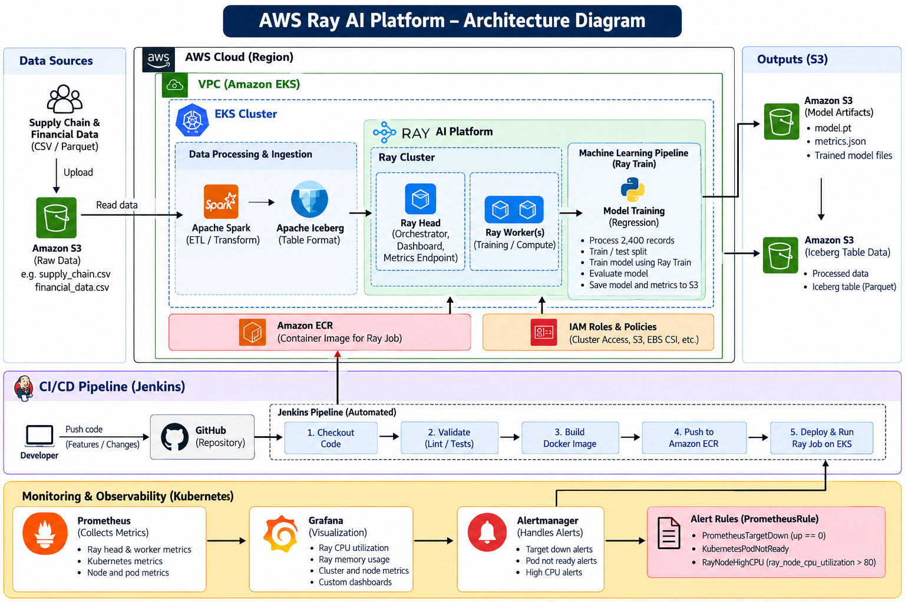

# AWS Ray AI Platform

An end-to-end machine-learning platform built with AWS, Kubernetes, and
Ray. This repository demonstrates data ingestion, model training, cloud
infrastructure, CI/CD automation, artifact storage, and monitoring.

> **Reference status:** The configured pipeline completed successfully
> in the tested AWS environment. A fresh deployment requires
> environment-specific AWS permissions and configuration.

## Table of Contents

-   [Overview](#overview)
-   [Architecture](#architecture)
-   [Technology Stack](#technology-stack)
-   [Repository Structure](#repository-structure)
-   [Prerequisites](#prerequisites)
-   [Clone and Prepare the
    Environment](#clone-and-prepare-the-environment)
-   [Configure AWS Access](#configure-aws-access)
-   [Deploy Infrastructure](#deploy-infrastructure)
-   [Deploy Ray and Run the Pipeline](#deploy-ray-and-run-the-pipeline)
-   [Verify the Results](#verify-the-results)
-   [Monitoring](#monitoring)
-   [CI/CD Workflow](#cicd-workflow)
-   [Troubleshooting](#troubleshooting)
-   [Cleanup and Cost Control](#cleanup-and-cost-control)
-   [Known Limitations](#known-limitations)

## Overview

The pipeline reads supply-chain and financial datasets from Amazon S3,
runs an Apache Iceberg ingestion stage, trains a regression model using
Ray Train, and writes model artifacts and evaluation metrics to S3.

Amazon EKS provides the Kubernetes environment. KubeRay manages the Ray
cluster and job resources. Jenkins automates the configured CI/CD
workflow, Amazon ECR stores container images, and Prometheus/Grafana
provide observability.

### Key capabilities

-   Amazon EKS infrastructure managed with Terraform.
-   Ray head and worker resources managed through Kubernetes/KubeRay.
-   S3-based data input and artifact output.
-   Apache Iceberg ingestion/table workflow.
-   Ray Train model training and evaluation.
-   Jenkins-based build and job execution workflow.
-   Prometheus metrics, Grafana dashboards, and custom alert rules.

## Architecture



### Architecture flow

1.  Source supply-chain and financial datasets are stored in Amazon S3.
2.  The pipeline reads and processes the source records and runs the
    Iceberg ingestion stage.
3.  Amazon EKS runs the Ray cluster, including a head node and worker
    node(s).
4.  Ray Train runs the regression-training workflow and evaluates the
    model.
5.  The model, metrics, and training checkpoints are stored in Amazon
    S3.
6.  Jenkins retrieves source code, performs configured checks, builds
    and publishes a container image, and runs the Ray job.
7.  Prometheus scrapes metrics, Grafana displays dashboards, and
    Prometheus alert rules evaluate selected conditions.

> The diagram is an architecture overview. Only describe components as
> implemented and tested if you can point to corresponding code,
> manifests, pipeline logs, or live resources. The reviewed pipeline
> logs confirm direct S3 ingestion and Iceberg processing; they do not
> by themselves establish that Apache Spark executed.

## Technology Stack

  Area                           Technologies
  ------------------------------ ---------------------------------------------
  Cloud                          AWS, Amazon S3, Amazon EKS, Amazon ECR, IAM
  Infrastructure as Code         Terraform
  Containers and orchestration   Docker, Kubernetes, KubeRay
  Distributed computing          Ray, Ray Train
  Data and ML                    Python, pandas, Apache Iceberg
  CI/CD                          GitHub, Jenkins
  Monitoring                     Prometheus, Grafana, Alertmanager
  CLI tools                      AWS CLI, kubectl, Helm, Terraform

## Repository Structure

``` text
ray-ai-platform/
├── app/
│   ├── data/
│   │   ├── financial_data.csv
│   │   └── supply_chain.csv
│   ├── create_iceberg_table.py
│   ├── generate_datasets.py
│   ├── ray_pipeline.py
│   ├── run_pipeline.py
│   ├── train_model.py
│   ├── train_ray_model.py
│   └── upsert_iceberg.py
├── docker/
│   └── Dockerfile
├── kubernetes/
│   ├── raycluster.yaml
│   ├── rayjob-template.yaml
│   └── rayjob.yaml
├── terraform/
│   ├── networking/
│   └── eks/
├── Jenkinsfile
├── requirements.txt
├── requirements-train.txt
├── monitoring-values.yaml
├── ray-head-servicemonitor.yaml
├── ray-autoscaler-patch.yaml
├── ray-worker-patch.yaml
├── aws-ebs-csi-trust-policy.json
├── ray-glue-policy.json
├── s3-encryption.json
└── README.md
```

Generated outputs under `artifacts/` are ignored by Git and can be
downloaded from S3 after a successful run.

## Prerequisites

-   Git
-   Python and `venv`
-   AWS CLI
-   Terraform (for infrastructure provisioning)
-   Docker
-   kubectl
-   Helm
-   Access to an AWS account with permissions for the required resources
-   Jenkins access if running through CI/CD

Use an authorized IAM role or approved credential mechanism with
least-privilege permissions.

**Cost warning:** EKS, EC2 nodes, load balancers, EBS volumes, NAT
gateways, and other AWS resources can incur charges. Review Terraform
plans and check for unused resources.

## Clone and Prepare the Environment

``` bash
git clone https://github.com/Prashanth3004/ray-ai-platform.git
cd ray-ai-platform
```

### Windows PowerShell

``` powershell
python -m venv .venv
.\.venv\Scripts\Activate.ps1
pip install -r requirements.txt
```

Inspect `requirements-train.txt` and install it if required by the
selected execution path:

``` powershell
pip install -r requirements-train.txt
```

### Linux or macOS

``` bash
python3 -m venv .venv
source .venv/bin/activate
pip install -r requirements.txt
```

## Configure AWS Access

Configure the AWS CLI with an authorized identity or use your
organization's approved role/credential mechanism.

``` powershell
aws configure
aws sts get-caller-identity
aws configure get region
```

The reference environment used `us-east-1`. Use the region selected for
your own deployment.

The repository contains a `.bucket-name` file. Verify its contents and
update environment-specific values before running the pipeline. Do not
commit AWS access keys, secret keys, session tokens, or passwords.

## Deploy Infrastructure

Terraform is split between `terraform/networking/` and `terraform/eks/`.
Review `variables.tf`, `main.tf`, and `outputs.tf` in both directories
before provisioning. The exact variable values and dependency order are
environment-specific.

Start by validating the networking configuration:

``` powershell
terraform -chdir=terraform/networking init
terraform -chdir=terraform/networking fmt -check
terraform -chdir=terraform/networking validate
terraform -chdir=terraform/networking plan
```

Review the plan and apply only when you understand the changes and
costs. Then review the EKS configuration:

``` powershell
terraform -chdir=terraform/eks init
terraform -chdir=terraform/eks fmt -check
terraform -chdir=terraform/eks validate
terraform -chdir=terraform/eks plan
```

Apply only after confirming inputs, dependencies, and planned changes.
If the infrastructure already exists, inspect its state rather than
creating duplicate resources.

Configure kubectl for the deployed cluster. This example assumes cluster
name `ray-ai-platform` in `us-east-1`:

``` powershell
aws eks update-kubeconfig --region us-east-1 --name ray-ai-platform
kubectl get nodes
```

## Deploy Ray and Run the Pipeline

Review these manifests first and verify image references, namespaces,
bucket names, and resource settings:

-   `kubernetes/raycluster.yaml`
-   `kubernetes/rayjob.yaml`
-   `kubernetes/rayjob-template.yaml`

Check cluster access:

``` powershell
kubectl get nodes
kubectl get pods -A
kubectl get raycluster -A
```

Validate the RayCluster manifest before applying it:

``` powershell
kubectl apply --dry-run=client -f kubernetes/raycluster.yaml
```

After confirming its configuration, apply it and inspect the status:

``` powershell
kubectl apply -f kubernetes/raycluster.yaml
kubectl get raycluster -A
kubectl get pods -n default
```

Before submitting a RayJob, inspect `kubernetes/rayjob.yaml` and confirm
its image, job entry point, namespace, and S3/IAM configuration.
Validate and apply it only when configured for your environment:

``` powershell
kubectl apply --dry-run=client -f kubernetes/rayjob.yaml
kubectl apply -f kubernetes/rayjob.yaml
```

If `rayjob-template.yaml` is intended as a template with placeholders,
use it according to its contents instead. Do not apply both job
manifests blindly.

Watch the job and pods:

``` powershell
kubectl get rayjob,raycluster,pods -n default
kubectl logs <pipeline-pod-name> -n default
```

Replace `<pipeline-pod-name>` with the actual pod name. For CI/CD
execution, run the configured Jenkins job and inspect its console
output.

## Verify the Results

``` powershell
kubectl get rayjob,raycluster,pods -n default
aws s3 ls s3://YOUR_BUCKET_NAME/artifacts/
```

Replace `YOUR_BUCKET_NAME` with the bucket used by your deployment. The
reference run wrote:

-   `artifacts/model.pt`
-   `artifacts/metrics.json`
-   Training checkpoints under `artifacts/ray-train/`

Download the model and metrics when local copies are needed:

``` powershell
New-Item -ItemType Directory -Force .\artifacts | Out-Null
aws s3 cp s3://YOUR_BUCKET_NAME/artifacts/model.pt .\artifacts\model.pt
aws s3 cp s3://YOUR_BUCKET_NAME/artifacts/metrics.json .\artifacts\metrics.json
Get-Content .\artifacts\metrics.json
```

### Reference run metrics

  Metric               Recorded result
  ------------------ -----------------
  Pipeline status            `SUCCESS`
  Records used                   2,400
  Training records               1,920
  Test records                     480
  Ray workers used                   1
  R²                            0.6612
  MAE                       58,257,196

These are results from one run, not guaranteed outputs for every
environment. MAE is in the target variable's units; assess it against
the dataset scale and a baseline before making claims about model
quality.

## Monitoring

The monitoring stack uses Prometheus, Grafana, and Alertmanager. Service
names may differ if the installation changes.

### Prometheus

``` powershell
kubectl port-forward svc/monitoring-kube-prometheus-prometheus 9090:9090 -n monitoring
```

Keep the terminal open and browse to `http://localhost:9090`.

Example query:

``` promql
ray_node_cpu_utilization
```

Check that Ray head and worker series appear and that their targets are
`UP`.

### Grafana

In a separate PowerShell terminal:

``` powershell
kubectl port-forward svc/monitoring-grafana 3000:80 -n monitoring
```

Browse to `http://localhost:3000` and use the credentials configured for
the running instance. Never store a real password in this repository.

### Alert rules

The custom `ray-platform-alerts` PrometheusRule was configured for
target availability, Kubernetes pod readiness, and sustained high Ray
CPU utilization. Verify that the rules are loaded and evaluating. Alert
rules alone do not prove notification delivery; Alertmanager routes and
receivers must be configured and tested separately.

## CI/CD Workflow

The pipeline is defined in `Jenkinsfile`. The configured workflow
includes source checkout, validation, container image build, publishing
to Amazon ECR, and Ray job execution.

Review the Jenkinsfile and Jenkins console output for the exact stages
and parameters used in your environment. Ensure Jenkins has the required
AWS access and the configured image repository, tag, cluster, and job
settings are correct.

## Troubleshooting

### Ray job fails

``` powershell
kubectl get rayjob,raycluster,pods -n default
kubectl logs <pipeline-pod-name> -n default
kubectl describe pod <pipeline-pod-name> -n default
```

Inspect job logs, pod events, image references, IAM permissions, and
resource requests.

### Prometheus target is down

``` powershell
kubectl get servicemonitor -A
kubectl get svc,endpoints -A
```

Check ServiceMonitor selectors, Service labels, target ports, metrics
endpoints, and the Prometheus target error.

### Artifacts are missing locally

Artifacts are stored in S3 and do not automatically appear in the local
repository. Verify the S3 object paths and download them using the AWS
CLI.

### EBS persistent volume claim remains pending

Check the PVC, StorageClass, EBS CSI driver, and IAM permissions. Do not
delete a PVC unless you have confirmed its data can be discarded.

## Cleanup and Cost Control

Inspect resources before removing anything:

``` powershell
kubectl get rayjob,raycluster,pods -A
kubectl get pvc -A
```

Delete only resources you created and no longer need. If using
Terraform, review its state and destruction plan before running a
destroy operation. This can delete infrastructure and persistent data.
Retain S3 datasets and artifacts you need.

Review EC2 instances, EBS volumes, load balancers, NAT gateways, and
other billable resources after testing.

## Known Limitations

-   The reference training run used one Ray worker; multi-worker scaling
    has not been demonstrated.
-   The Iceberg upsert reported zero inserted and zero updated rows. The
    table contents and intended upsert behavior need further
    investigation.
-   The model's R² and MAE are initial evaluation results, not evidence
    of production readiness.
-   Alert notification delivery must be tested separately from rule
    evaluation.
-   Fresh deployment requires environment-specific Terraform inputs, AWS
    permissions, image references, and manifest configuration.

## License

Add a license if you intend to distribute or reuse this project
publicly.
